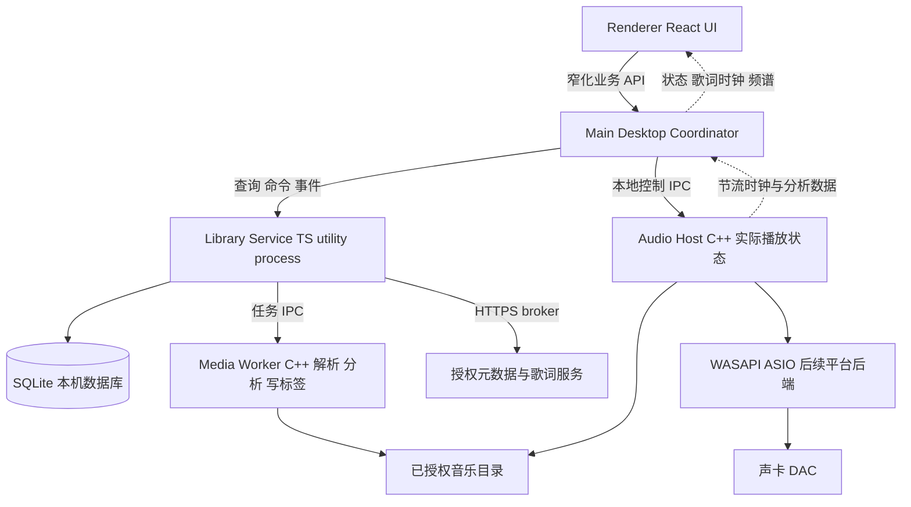
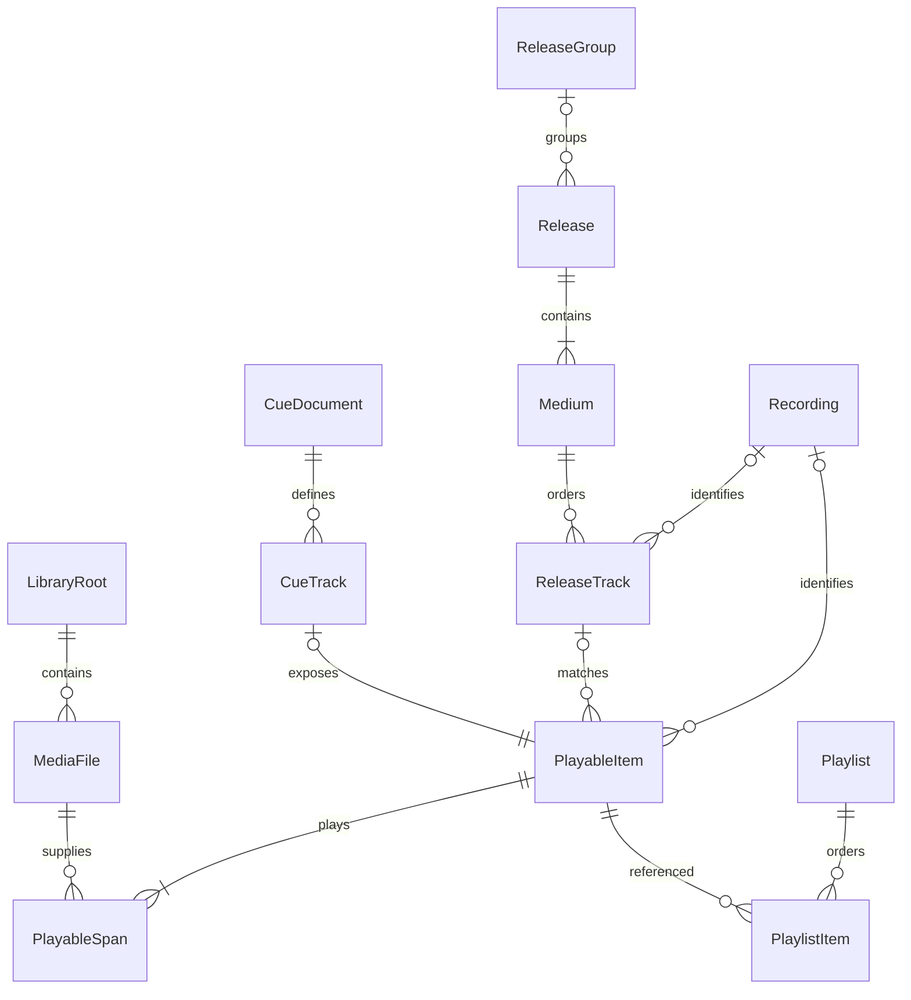
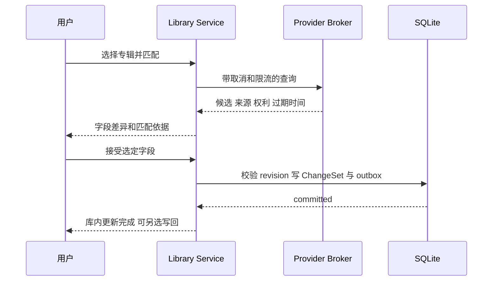
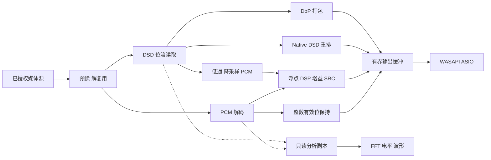
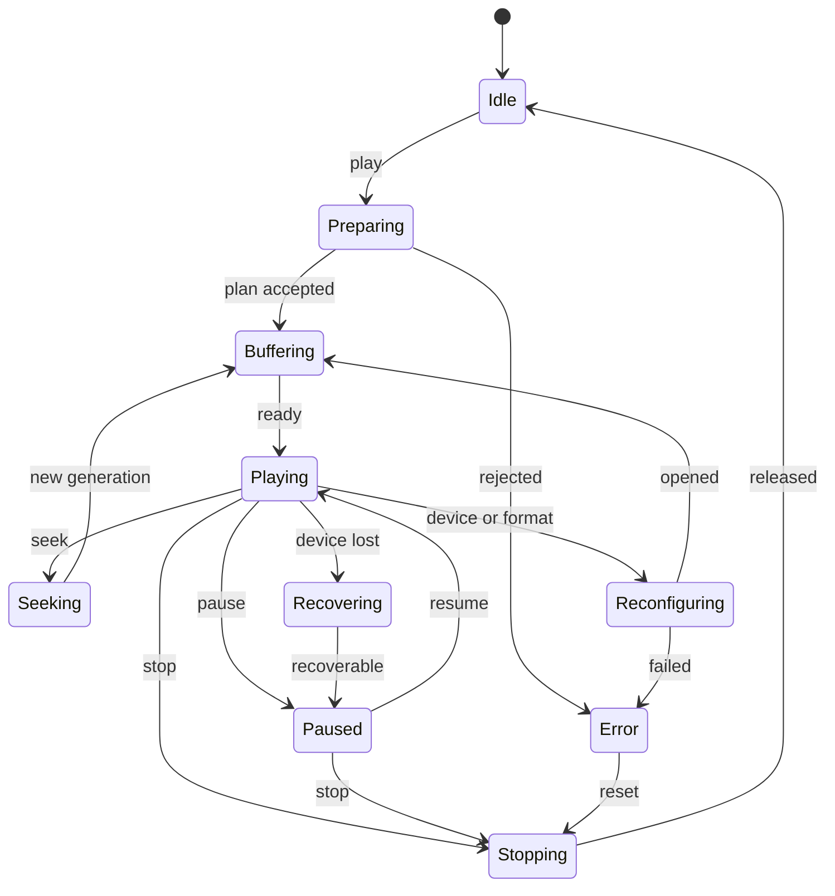

# 现代桌面音乐管理应用架构设计

版本 1.0 · 2026 年 9 月 28 日 · 面向产品评审与研发启动

本方案采用 **Windows 优先、后续扩展 macOS 和 Linux** 的路线，以本地音乐库为核心，覆盖音乐导入、分类浏览、模糊检索、在线元数据匹配、播放、WASAPI 独占、ASIO、DSD、歌词及可视化。推荐使用 **Electron + React + TypeScript 管理界面，SQLite 本地存储，独立 C++20 音频引擎**。应用离线可用，联网服务按能力接入，音频实时路径与数据库、扫描、网络和 UI 隔离。

本文件是研发基线设计，不是已实现产品的测试报告。用户已确认平台方向且没有既定技术栈；Windows 11 x64、十万可播放条目、四人核心团队、商业发行可行性审查均为本方案的规划假设。性能数值为验收目标，硬件兼容性和第三方授权要通过前期原型及发布门禁确认。文中 ASIO 对应需求中的“aiso”。

## 1 产品目标与设计原则

### 1.1 用户价值

用户能够把本地磁盘、移动硬盘或已挂载 NAS 中的音乐导入统一音乐库，按歌手、专辑、风格、文件夹和音质筛选；通过中文、拼音或模糊关键词找到音乐；补齐封面、曲名、发行版等信息；使用普通声卡或专业 DAC 播放；查看同步歌词和频谱，同时看清当前实际输出链。

首版无需账号或云端服务即可管理和播放本地音乐。在线匹配失败、授权到期或服务限流不影响本地功能。软件管理音乐引用和用户修订，默认不移动、转码、切割或覆盖原音乐文件。

### 1.2 核心原则

1. **播放优先**：音频回调不访问文件、网络或数据库，不等待 UI，不执行不可控插件代码。
2. **数据可解释**：原始标签、在线观察值、用户编辑和最终展示值分别保存，任何自动建议都能说明来源。
3. **能力显式**：读取格式、解码、标签写回、设备输出分别报告；不把“能解码”写成“支持原生输出”。
4. **故障可恢复**：扫描可续跑，元数据更新可撤销，写回有恢复日志，数据库升级有一致快照。
5. **按边界扩展**：平台输出、元数据源、歌词源、解码器与可视化均有独立契约，首版只开放内部扩展接口。
6. **验证驱动选型**：先验证 ASIO、DSD 和 CUE，再冻结音频引擎工期；界面演示不能代替音频验证。

## 2 范围与需求追踪

“MVP”指内部可用里程碑，“V1”指覆盖本次核心需求的 Windows 发布范围；不能以 MVP 代替全部需求交付。

| 编号 | 能力及范围 | 责任模块 | 交付阶段与验收入口 |
|---|---|---|---|
| FR01 | FLAC、WAV、MP3、AAC/M4A、ALAC、Ogg Vorbis、Opus 播放 | Media / Audio | MVP，格式金样及随机 seek |
| FR02 | 单文件和多文件 CUE 虚拟轨、内嵌 FLAC CUESHEET | Library / Media / Audio | V1，边界与专辑连续性测试 |
| FR03 | DSF、未压缩 DFF；DSD64/128，DSD256 按设备能力 | Media / Audio | V1，转换、Native、DoP 分别验收 |
| FR04 | 歌手、专辑、风格、文件夹、最近添加、收藏、歌单 | Library / UI | MVP，多艺人、多碟、再版数据集 |
| FR05 | 中文短词、子串、拼音和首字母、英文错拼、组合过滤 | Search | MVP 基础，V1 完整，十万库基准 |
| FR06 | 在线匹配、候选比较、封面、字段来源、批量审核与撤销 | Metadata | V1，标注真值集及网络故障测试 |
| FR07 | 播放队列、顺序/随机/单曲/列表循环、收藏和播放历史 | Playback | MVP，队列重排、恢复和多窗口一致 |
| FR08 | WASAPI shared、exclusive 及实际参数展示 | Audio | MVP，真实 Windows 声卡和 USB DAC |
| FR09 | 厂商 x64 ASIO 驱动、控制面板、缓冲及设备切换 | Audio | V1，真实 ASIO 驱动矩阵 |
| FR10 | 本地/内嵌歌词、LRC 行同步、偏移、双语层 | Lyrics | MVP；在线授权源、字同步能力 V1 按源验证 |
| FR11 | 电平、频谱、波形、全屏播放视图 | Analysis / UI | V1，开启后不增加播放欠载 |
| FR12 | 库内编辑；已认证格式的可恢复标签写回 | Metadata / TagWriter | V1，差异预览和故障恢复 |
| FR13 | 备份恢复、增量扫描、设备失效、崩溃诊断与签名更新 | Platform / Library | 自 MVP 起建设，V1 发布门禁 |
| FR14 | 平台后端与数据源扩展契约 | Contracts / Adapters | V1，契约测试及替身适配器验证 |

后续范围包括 macOS/Linux 成品、多声道完整交付、SACD ISO/DST、云同步、远程控制、多房间播放、转码/刻录、VST/AU 等第三方 DSP 宿主和公开插件商店。它们有预留点，但不计入 V1 的实现承诺。APE、WavPack、AIFF 可作为格式扩展批次，不能仅凭依赖宣称支持就跳过验收。

## 3 平台与格式能力矩阵

### 3.1 平台基线

| 平台 | 管理及 UI | 输出后端 | 边界 |
|---|---|---|---|
| Windows 11 x64 | 首发主平台 | WASAPI shared/exclusive，厂商 ASIO | x64 宿主要求匹配位数驱动；普通用户运行 |
| Windows ARM64 | 暂不承诺 | 独立构建与驱动验证后确定 | x64 仿真不能证明 ASIO 兼容 |
| macOS Apple Silicon | 后续阶段 | CoreAudio，设备独占相关能力另行验证 | 不承诺与 Windows ASIO 完全对等；DSD 按设备验证 |
| Linux x64 | 后续阶段 | PipeWire 为桌面集成候选，ALSA 直连为高级输出候选 | 发行版、音频服务和设备权限需独立矩阵 |

Windows 10 或旧平台支持属于兼容扩展，须明确所选 Electron 版本、安全维护周期及测试成本后立项。操作系统支持范围由发行 manifest 固定，文档不锁定会过期的“当前最新版”号。

### 3.2 文件能力不是一个布尔值

| 对象 | V1 读取和播放目标 | 标签策略 | 关键限制 |
|---|---|---|---|
| FLAC | 16/24-bit，常见 PCM 采样率 | 读；写回经回归后开放 | 无损解码与 bit-perfect 输出分别验收 |
| WAV/RF64 | PCM16/24/32、float32；RF64 探测和读取 | 读 INFO/ID3 等；V1 默认库内编辑 | 标签生态有差异，不能无损保留未知 chunk 时禁止写回 |
| MP3/AAC/ALAC/Vorbis/Opus | 按固定解码构建覆盖 | 格式适配器报告逐字段可写性 | 有损无缝依赖 delay/padding 等信息 |
| 外部 CUE | 解析后引用音频，不单独解码 | 原文保留；库内修订；CUE 写回单独审阅 | 缺少引用文件时仍可显示诊断，不伪造可播放性 |
| FLAC CUESHEET | 转换为统一虚拟轨模型 | 保留原块及来源 | 内嵌结构和外部 CUE 文本不是同一格式 |
| DSF / 未压缩 DFF | DSD→PCM、Native DSD、DoP 按能力分别实现 | 标签读取；写回首版默认禁用 | DSD256 和更高速率不作全设备保证 |
| DST 压缩 DFF / SACD ISO | V1 明确不支持 | 不改写 | 扩展名 DFF 不能区分是否 DST，须探测 |

解码能力必须由实际打包组件的测试生成 `MediaCapabilityManifest`。容器、编码、位深、采样率、声道组合超出认证范围时显示原因，而不是仅按文件后缀放行。TagLib 官网列出 FLAC、WAV、DSF、DFF 等标签格式；具体字段保存能力仍需本项目回归。[TagLib](https://taglib.org/)

## 4 技术选型与架构决策

### 4.1 推荐技术栈

| 层 | 选择 | 选择理由与维护代价 |
|---|---|---|
| 桌面壳 | Electron 受支持稳定版本 | UI 运行时一致，桌面生态完整；承担 Chromium/Node 更新和包体成本 |
| UI | React + TypeScript，Vite 构建 | 组件化、列表虚拟化、主题及歌词绘制；不承担音频实时处理 |
| UI 状态 | 查询缓存 + 小型本地状态 store | 曲库查询、实际播放状态、临时交互状态分离，避免重复权威状态 |
| 本地业务 | TypeScript Library Service | 统一业务规则、数据库、索引任务和 Provider 编排 |
| 数据库 | SQLite + FTS5 | 无独立服务，关系查询和本地检索；版本固定到已修复已知问题的发行版 |
| 数据库绑定 | better-sqlite3 候选，置于 utility process | 同步 API 易管理事务；Electron ABI 重编译及大查询阻塞需验证 |
| 原生媒体 | C++20 + CMake + 固定依赖清单 | FFmpeg/TagLib/ASIO 生态接入直接；要求明确 RAII、线程及 ABI 边界 |
| 解复用与解码 | FFmpeg libraries 受控构建 | 共用 Probe/Decode 能力；不依赖系统任意 FFmpeg 安装 |
| 标签 | TagLib 封装为 TagAdapter | 不让业务依赖某格式库的类型或保存行为 |
| 输出 | 自有 WASAPI 后端 + ASIO SDK 适配 | 控制实际格式、设备生命周期和直通；实机兼容成本是主要风险 |
| UI 绘制 | Canvas/WebGL2，CSS 普通交互 | V1 不依赖 WebGPU；低性能设备可降级关闭动态效果 |
| 契约与测试 | JSON Schema，TS/C++ 生成或校验，单元及集成测试 | 控制跨语言协议漂移；代码生成方案在原型阶段固定 |

这里的 Electron 是管理界面和桌面集成方案。音乐播放由独立原生进程直接访问输出后端，不用 HTMLAudio/Web Audio 实现 ASIO 或独占输出。独立 EXE 也减少了音频引擎对 Electron 原生 addon ABI 的耦合；数据库 addon 仍需单独验证。

### 4.2 备选与切换条件

| 方案 | 优点 | 不作为默认的原因 | 何时重新评估 |
|---|---|---|---|
| Tauri + React + Rust 核心 + C++ 音频 | 系统 WebView 路线，核心可用 Rust | 当前无团队 Rust 偏好；增加 Rust/C++ 边界和 WebView 差异测试 | Electron 的实测资源指标无法接受，且团队愿意长期维护 Rust |
| Qt + C++ | 原生一体化，较少语言边界 | 现代复杂音乐库 UI 和前端招聘/协作方式需另评估 | 团队转为 C++ 主导，或有严格内存/嵌入式要求 |
| BASS 系列原生引擎 | 可缩短高级音频功能原型时间 | 商业授权及闭源依赖，add-on 能力不完全相同 | 自有输出后端未过门禁、时间优先且授权可接受 |
| JUCE | 音频设备、DSP 和插件生态 | 首版不需要完整 DSP 宿主；不能据高层 PCM API 假设原生 DSD 能力 | 后续明确开发专业 DSP/插件宿主 |

Tauri 官方说明使用系统 WebView；Electron 官方将 `utilityProcess` 定义为运行 Node 模块的辅助进程。此处的 C++ Audio Host 是单独可执行文件，不通过 `utilityProcess.fork` 启动。[Tauri 进程模型](https://tauri.app/concept/process-model/)、[Electron utilityProcess](https://www.electronjs.org/docs/latest/api/utility-process)

### 4.3 决策记录

| ADR | 决策 | 代价与重新评估条件 |
|---|---|---|
| ADR01 | Windows 优先，平台差异封装在后端 | 后续平台单独验收，不以接口存在代替实现 |
| ADR02 | Electron 管理面 + C++ 原生音频 | 两套工具链；只有实测或团队条件改变才替换 |
| ADR03 | 一个本地产品，模块化单体加工作进程 | 不引入微服务、Redis、Kafka 或本地 HTTP 服务 |
| ADR04 | SQLite 单写入所有者 | 重查询和索引需要预算；百万级扩展后才讨论新搜索服务 |
| ADR05 | 文件、可播放条目、录音、发行版分离 | 模型稍复杂，避免 CUE/再版/多音质后期重构 |
| ADR06 | 元数据入库与源文件写回分离 | 需要修订日志与写回队列，换取可恢复性 |
| ADR07 | PCM 直通、PCM 处理、DSD 位流独立路径 | 不能把所有音频统一转换为 float32 |
| ADR08 | V1 仅内置可信插件，预留公开契约 | 公开第三方原生插件需另做实时性及隔离设计 |

## 5 进程架构与运行边界



| 进程 | 所有权 | 禁止职责 | 崩溃影响与恢复 |
|---|---|---|---|
| Renderer | 视图、交互、可视化绘制 | DB、任意文件访问、驱动加载、联网密钥 | 音频继续；重建后取快照，不能重发旧播放命令 |
| Main | 窗口/托盘/快捷键、IPC 校验、子进程生命周期、播放命令编排 | 扫描、长 SQL、指纹、大图片、实时音频 | 主进程退出后子进程受 Job Object/看门狗约束结束并释放设备 |
| Library Service | 曲库、队列意图、用户数据、唯一写连接、任务调度、HTTP broker | 驱动回调、播放 PCM 传输 | 音频可播已缓存队列；恢复前只读/控制受限，禁止第二写入者 |
| Media Worker | 探测、标签、CUE、封面转换、波形/指纹、写回 | 音频设备、直接写 DB、任意联网 | 单文件任务失败并隔离，限次数重试 |
| Audio Host | 实际播放状态、输出时钟、解码、缓冲和设备 | 曲库 DB、HTTP、标签写回、UI | 停止播放；保留业务队列，重启后默认暂停待继续 |

Library Service 可在 utility process 内使用有界任务执行器；CPU 密集媒体工作送至 Media Worker。V1 不为每张专辑启动进程。Media Worker 按需启动，默认最多两个解析/分析并行槽，播放时降低分析优先级。实际并发和内存预算由原型校准。

Renderer 与 Main 使用 Electron IPC；Main 与 Library 使用消息端口；原生进程统一使用长度前缀 JSON 控制协议，通过 Windows 命名管道传输。macOS/Linux 替换为 Unix domain socket。命名管道仅本机当前用户访问，带随机会话标识和握手令牌。音频块全部留在 Audio Host 内。

进程分离负责故障隔离，不自动构成安全沙箱。Renderer 启用沙箱；原生进程的令牌、目录权限及驱动兼容性须分别验证。ASIO 必须运行于能访问厂商驱动的用户上下文，不能承诺任意严格沙箱都可兼容。

## 6 模块边界与代码组织

| 模块 | 输入与输出 | 持有的业务规则 |
|---|---|---|
| Library | 目录、扫描结果 → 可播放条目/分类视图 | 文件身份、离线状态、实体关联、去重展示 |
| Catalog | 标签/用户编辑 → 艺人/发行版/录音等 | 多艺人角色、具体发行版、字段来源 |
| Search | 查询和过滤 → 有序 ID 页 | 规范化、召回、重排、索引版本 |
| Metadata | 查询上下文 → 候选/ChangeSet | 置信分层、授权、冲突和撤销 |
| Playback | 队列意图/操作 → 播放计划与实际状态 | 随机顺序、循环、恢复、输出策略 |
| Audio Engine | TrackLocator/PlaybackPlan → 音频和时钟 | 解码、DSP、直通、设备实时行为 |
| Lyrics | 曲目/源/时钟 → 解析文档和当前行 | 来源优先、时间基、偏移和版权状态 |
| Analysis | 只读样本副本 → 频谱/电平/波形/指纹 | 工作预算、缓存算法版本、丢帧策略 |
| Platform | OS 事件 → 桌面能力 | 托盘、媒体键、单实例、更新、凭据 |

依赖方向为 UI → 应用用例 → 领域接口 → 适配器。领域逻辑不引用 React、Electron、FFmpeg 或驱动类型。在线 Provider 只产出候选，TagWriter 只执行已审阅计划，两者均不能自行修改规范曲库。

```text
apps/desktop/             Electron main preload renderer
services/library/         catalog scan search metadata jobs repositories
native/audio-host/        transport clock buffer decoder output
native/media-worker/      probe cue tags artwork analysis writeback
native/media-core/        两个原生程序共享的非实时媒体适配代码
packages/contracts/       JSON Schema 类型 错误码 兼容性测试
packages/domain/          纯 TS 业务规则 不含桌面框架
packages/providers/       内置元数据 封面 歌词适配器
database/migrations/      迁移脚本 校验和 恢复说明
tests/fixtures/           授权金样及生成器 不收集用户音乐
tests/integration/        IPC 扫描 元数据 写回 升级
tests/hardware/           设备测试脚本 证据 manifest
docs/adr/                 架构决策及变更理由
build/                    打包 签名 依赖清单 许可证
```

## 7 领域模型与关系

### 7.1 身份分离

`MediaFile` 是物理文件记录，路径可变；`PlayableItem` 是 UI、歌单和播放历史引用的可播放条目；`Recording` 是录音身份；`ReleaseTrack` 是具体发行版的一轨；`Release` 是某国别、年份或版本的发行；`ReleaseGroup` 才是“同一张专辑概念”的聚合。线上 ID 均为可选外部引用，不作为本地主键。



一个完整音频文件通常对应一个 whole-file 条目，一张整轨 FLAC 加 CUE 则对应多个 cue 条目。一个条目可有多个有序 `PlayableSpan`，支持跨文件引用。扫描同时保留 whole-file 和 cue 记录，但有效 CUE 存在时默认隐藏重复整轨展示，不能删掉资产。

一首录音可能出现在多张发行版中；一个发行版曲目可能有 FLAC、MP3、DSD 多个本地版本。音乐库保留各个可播放版本，UI 可折叠音质版本；指纹相近不能自动删除文件，也不能直接认定属于同一发行版。此模型与 MusicBrainz 对录音、发行的区分一致。[Recording](https://musicbrainz.org/doc/Recording)、[Release](https://musicbrainz.org/doc/Release)

### 7.2 艺人 专辑和风格

艺人身份与署名字符串分离，保存艺人 ID、角色、显示顺序及连接词，保留“甲 feat. 乙”原始呈现。曲目歌手与专辑艺人是不同字段；同时支持作曲、指挥、乐团、演奏者。不得对所有标签强制按斜杠拆艺人名。

专辑不能用标题作唯一键。在线发行 ID 为空时先按专辑艺人、标题、根目录/目录上下文、碟号等生成本地分组候选；有歧义时允许拆分/合并并记录修订，不自动把同名专辑、再版和合辑混在一起。

风格为多对多，可含用户分类和 Provider 分类。显示时区分来源；自定义风格名称和层级不因远端更新消失。古典作品/乐章模型通过可选 `Work/WorkPart` 扩展，不要求 V1 完整实现。

## 8 数据库设计与持久化

### 8.1 物理约定

本地 UUID 用 TEXT 保存；微秒时间、tick、文件大小、修订号使用 64-bit INTEGER；枚举用受 CHECK 约束的 TEXT；UTC 时间戳统一毫秒整数。跨 JS/JSON 的可能超出安全整数范围的 64-bit 数值用十进制字符串传输。展示文本与搜索规范文本分别保存。

SQLite 位于本机应用数据目录。采用单写连接、短事务、WAL、`foreign_keys=ON`、有界 busy 重试；V1 默认 `synchronous=FULL` 保护已确认用户编辑的持久性，扫描通过小批次减少写开销。长时间读事务与强制 checkpoint 不进入交互关键路径。SQLite WAL 不支持把活动数据库放网络文件系统进行多机共享。[SQLite WAL](https://sqlite.org/wal.html)

### 8.2 关键表数据字典

下表是逻辑和物理设计基线；实际迁移需生成完整 DDL 和索引，并经约束测试后冻结。本文中的示例 SQL 不是已执行的生产迁移。

| 表 | 关键列 | 约束及用途 |
|---|---|---|
| library_root | id, uri, platform, volume_id, writable, status, scan_generation | URI 指向授权根；离线不能触发清库 |
| media_file | id, root_id, relative_path, path_key, file_identity, size, mtime, hash, content_revision, status | UNIQUE(root_id,path_key)；file_identity 非跨平台全局唯一；hash 可为空且不唯一 |
| media_stream | id, file_id, stream_index, codec, source_kind, rate, channels, channel_layout, valid_bits, total_ticks | UNIQUE(file_id,stream_index)；DSD rate 明確为每声道 bit-sample rate |
| playable_item | id, kind, recording_id?, release_track_id?, title, duration_us, visible, revision | 用户引用稳定；kind=whole/cue/future |
| playable_span | item_id, ordinal, stream_id, start_tick, end_tick, time_base_num, time_base_den | PK(item_id,ordinal)；end>start；区间左闭右开；未知末端可为空 |
| cue_document | id, file_id?, owner_audio_file_id?, raw_ref, charset, parser_version, revision, diagnostics | 外部 CUE 与内嵌 CUESHEET 来源分开标识 |
| cue_track | id, cue_id, item_id, ordinal, track_no, index00, index01, pregap, postgap, raw_fields | UNIQUE(cue_id,ordinal)；不能只用 TRACK 号保证合法性 |
| artist | id, name, sort_name, normalized_name, disambiguation | 同名允许，线上 ID 在 external_ref |
| artist_credit | id, display_text | 一组有序署名；可由录音/发行/发行曲目引用 |
| artist_credit_member | credit_id, ordinal, artist_id, role, join_phrase | 多对多；保留表演角色和连接文本 |
| release_group | id, title, type | 专辑概念；无在线匹配也可为空 |
| release | id, group_id?, artist_credit_id?, title, date, country, label, catalog_no, barcode, edition | 不对 title 做唯一约束；日期保留 year/month/day 精度 |
| medium | id, release_id, disc_no, title, format | UNIQUE(release_id,disc_no) |
| recording | id, title, artist_credit_id?, duration_us, version_label | live/remix 等版本信息单列，不能单凭同名合并 |
| release_track | id, medium_id, position, printed_number, recording_id?, artist_credit_id?, title | UNIQUE(medium_id,position)；印刷轨号可为非数字 |
| genre | id, name, normalized_name, parent_id? | 自定义分类树需阻止循环 |
| item_genre / release_genre | entity_id, genre_id, source, revision | 每种实体独立 FK，避免无约束多态关联 |
| external_ref | entity_kind, entity_id, provider, external_id, url | Provider 内稳定引用；应用层检查实体类型与归属 |
| metadata_observation | id, entity_kind, entity_id, field, value_json, source, rights_id, fetched_at | 原始观察值不可被展示合并覆盖；受来源保存期限约束 |
| field_decision | entity_kind, entity_id, field, observation_id?, override_json?, locked, revision | 一字段一个生效决定，事务校验基础修订 |
| changeset / change_entry | id, actor, reason, base_revision, before_json, after_json, source, created_at | 人工/匹配/撤销审计；保留信息服从来源条款 |
| artwork | id, content_hash, cache_path, mime, width, height, source, rights_id, expires_at | 图像文件存磁盘；绑定通过 item_artwork/release_artwork 等明确关系 |
| lyrics_document | id, item_id?, recording_id?, kind, language, raw_ref, parsed_ref, offset_us, revision, rights_id | 版本匹配优先 item；解析行按文件保存或子表 |
| playlist / playlist_item | id, name, kind, filter_json / playlist_id, entry_id, item_id, position | 静态歌单允许同曲重复；智能歌单保存白名单过滤 DSL |
| queue / queue_entry | id, revision, mode, shuffle_seed / entry_id, item_id, position | 同曲多次入队有独立 entry_id；实际游标按 entry_id |
| playback_history / item_user_state | session_id, entry_id, item_id, presented_us / rating, favorite, play_count | 播放记录幂等；与可重扫元数据分离 |
| job / job_checkpoint | id, kind, key, state, attempts, next_run_at, lease, payload / cursor | 唯一任务键防重复，租约到期可恢复 |
| outbox / search_document | seq, aggregate_id, revision, type / item_id, searchable_fields | 规范数据与 outbox 同事务；索引最终一致 |
| provider_rights / provider_cache | source, terms_version, actions, expires / key, etag, blob_ref, expiry | 缓存许可与字段来源关联，禁止永久默认缓存 |
| writeback_operation | id, file_id, source_revision, status, backup_ref, temp_ref, receipt | 文件系统与 DB 非同一事务，逐阶段恢复 |
| schema_migrations / app_setting | version, checksum, state / key, value, revision | 设置加 schema；不保存明文密钥 |

所有 `entity_kind + entity_id` 多态表通过统一 Catalog Repository 校验，不能伪称 SQLite FK 可直接约束任意实体。核心分类和所有权关系优先使用显式 FK；待关系规模确定后可进一步拆分多态表。

### 8.3 索引与一致性

关键 B-tree 索引覆盖 `root_id/path_key`、`root_id/file_identity`、`status/last_seen_generation`、`release_track.medium_id/position`、艺人署名成员的反向关联、风格关联、`job.state/next_run_at`、`history.item_id/created_at`。分页采用排序值加 ID 的键集游标；不加载全库到 Renderer，也不对深页依赖巨大 OFFSET。

常用标题、艺人、专辑、时长和音质是规范强类型字段；JSON 用于原始标签、Provider 响应和扩展数据，不把所有查询变成扫描 JSON。列表读取 `LibraryItemView` 派生模型，必要的封面/艺人汇总冗余可从规范表重建。

目录、队列、用户状态与元数据写入使用本地事务。索引允许短暂滞后，事件中带 `catalog_revision/index_revision`；用户刚修改标题的详情页立即反映生效值，搜索可显示“索引更新中”。禁止在写入失败时提前发送成功事件。

```sql
-- 示例，仅说明片段不变量，完整 migration 在研发阶段生成
CREATE TABLE playable_span (
  item_id TEXT NOT NULL REFERENCES playable_item(id),
  ordinal INTEGER NOT NULL CHECK (ordinal >= 0),
  stream_id TEXT NOT NULL REFERENCES media_stream(id),
  start_tick INTEGER NOT NULL CHECK (start_tick >= 0),
  end_tick INTEGER,
  time_base_num INTEGER NOT NULL CHECK (time_base_num > 0),
  time_base_den INTEGER NOT NULL CHECK (time_base_den > 0),
  PRIMARY KEY (item_id, ordinal),
  CHECK (end_tick IS NULL OR end_tick > start_tick)
);
```

## 9 导入 扫描与文件生命周期

### 9.1 扫描流水线

用户授权根目录 → 枚举和 stat → 文件稳定性检查 → 轻量探测 → 标签/CUE 解析 → 批次事务入库及 outbox → 后台封面缩略图/波形/指纹。首次扫描边扫描边可浏览；深度哈希、指纹和完整波形不阻塞第一批结果。

任务状态为 `queued → running → succeeded/failed/cancelled`，可重试失败进入带 `next_run_at` 的等待状态；断点记录最后安全批次和 scan generation。取消在文件或小块边界响应，超时原生解析任务可结束该 worker。异常文件进入隔离清单，不中断整个根目录。

### 9.2 增量规则

文件监视器只是变化提示：合并重复事件、去抖、处理 rename 成对/缺失事件；启动、重连以及监视器溢出后做对账。未完整遍历成功的子目录不能参与 missing 判定。根目录不可达标为 offline/unavailable，保留歌单、评分、收藏、历史与封面。

本机 file ID/volume ID 优先辅助识别改名；不可靠时用大小/时间戳筛选后再做可选哈希确认。路径或 inode/file ID 均不能独自作为永久身份；跨盘复制默认形成新资产，后续提供重复建议。完整字节 hash 不等同于音频内容 hash，修改标签可能改变前者而不改变音频。

只把文件已稳定且解析通过的版本替换为新 content revision。外部程序正在写入、下载未完成、网络短断时保留旧可用记录及警告。符号链接/重解析点默认不递归；如用户开启，必须检测循环并校验仍在授权边界内。

### 9.3 CUE 扫描协调

扫描完成一个目录批次后解决 CUE 引用，再计算展示条目。统一规范化引用路径并保留原文；根内相对 `..` 可在规范化后合法，逃逸授权根的路径需要新授权，不能由 CUE 自动扩大访问范围。两个 CUE 引用同一镜像时保留不同编排，默认要求用户选择主编排，避免自动重复展示。

“从库中移除”“忽略此文件”“删除原文件”是不同操作。V1 仅默认提供前两项；如果实现物理删除，单独显示影响文件数、CUE 关联和回收站可用性，禁止通过扫描清理隐式删除用户音频。

## 10 分类浏览与模糊搜索

### 10.1 视图契约

歌手视图按明确角色过滤，可切换曲目艺人/专辑艺人；专辑视图展示具体版本并可按 ReleaseGroup 折叠；风格支持多标签交集/并集；文件夹视图反映物理位置但仍播放 PlayableItem；音质筛选区分编码、源采样率、位深、DSD rate 与实际输出状态。

所有列表支持服务器式本地分页、稳定排序、批量操作、键盘选择、右键菜单、空态/离线态和错误提示。封面采用多尺寸缓存、延迟加载、内存 LRU；禁止原图全部转 Base64 放进 Renderer 状态。

### 10.2 检索流水线

原文保留 → Unicode 规范化/大小写折叠/标点空白处理 → 别名、繁简、拼音及首字母派生 → 多路召回 → 结构化过滤 → 有界候选重排 → 键集分页。拼音词典和繁简映射版本写入索引版本，多音字允许用户别名纠正。

| 查询类型 | V1 实现 | 示例与限制 |
|---|---|---|
| 标题/歌手精确或前缀 | 规范列 + FTS5 unicode61 前缀 | 精确命中排名最高 |
| 三字及以上子串 | FTS5 trigram | 中文/英文连续子串；不是语义相似 |
| 一到两字中文 | 独立 unigram/bigram 倒排表 | 支持“周”“周杰”；候选过多时按过滤/热度限额并提示细化 |
| 拼音/首字母 | 独立派生字段及前缀索引 | zhoujielun / zjl；多音字通过词典和别名 |
| 英文错拼 | n-gram 候选召回 + 编辑距离重排 | 不对十万曲逐行计算距离；短中文禁用宽松纠错 |
| 组合条件 | 参数化 SQL 查询计划 | 歌手 + 风格 + 年份 + 无损 + 收藏 |

SQLite 的 `unicode61` 不等于中文词法分词；trigram 的 MATCH 对不足三个 Unicode 字符的查询不命中，因此必须有短中文路径。FTS5 的 LIKE/GLOB 优化也有条件，不能假设任意 `%词%` 查询都走索引。[SQLite FTS5](https://www.sqlite.org/fts5.html#the_trigram_tokenizer)

用户输入最长建议 256 字符，200 ms 去抖；以 query ID 和取消令牌丢弃过期响应。原始输入不能直接拼入 SQL 或 MATCH 语法。首轮模糊重排上限建议 300 个候选，输出同时带匹配原因；数值通过十万库测试再固定。

空查询走分类列表。排序初始规则为精确标题、精确艺人/别名、前缀、子串、纠错，然后结合字段权重和用户选择排序。个性化不能让明显精确命中被模糊结果淹没。

## 11 在线元数据匹配

### 11.1 Provider 分工

MetadataProvider、ArtworkProvider、FingerprintProvider、LyricsProvider 分别注册能力；“可查询标签”不代表能提供可缓存、可导出封面或歌词。所有 Provider 返回来源、实体身份、时间、授权动作和过期策略。

| 来源 | 推荐用途 | 已核实约束与项目处理 |
|---|---|---|
| MusicBrainz | 录音/艺人/发行版主标识及文本元数据 | 核心数据 CC0，补充数据另有条款；API 商用访问条件单独确认。公共调用按约 1 请求/秒规则及可识别 User-Agent 调度 |
| Cover Art Archive | 按 Release MBID 获取封面候选 | 访问可用不等于封面版权开放；缓存、显示、导出分别处理 |
| AcoustID + Chromaprint | 缺标签时用本地音频指纹查录音候选 | 公共免费服务限非商业、最多 3 请求/秒；商用服务条件与软件许可分别审查 |
| Discogs | 可选补充具体版本信息 | 缓存及内容新鲜度条款可能不适合永久离线库，V1 默认不启用，取得适用授权后开放 |
| 中文音乐服务 | 中文发行/艺人信息补充 | 按正式 API 和合同接入；网页可访问、特定 IoT API 不等于桌面软件通用授权 |
| 授权歌词服务 | 行/字同步和翻译 | 按地区、展示、缓存、离线、导出和署名权限启用 |

来源依据：[MusicBrainz 数据许可](https://musicbrainz.org/doc/About/Data_License)、[MusicBrainz API](https://musicbrainz.org/doc/MusicBrainz_API)、[限速规则](https://musicbrainz.org/doc/MusicBrainz_API/Rate_Limiting)、[Cover Art Archive](https://musicbrainz.org/doc/Cover_Art_Archive)、[AcoustID](https://acoustid.org/webservice)、[Discogs API 条款](https://support.discogs.com/hc/en-us/articles/360009334593-API-Terms-of-Use)。上述约束核对于 2026 年 9 月 28 日，发布时按实际用途复核。

### 11.2 匹配工作流

1. 读取有效外部 ID 并校验实体种类；不盲信来源不明标签中的 ID。
2. 以本地标题、艺人、专辑、曲目顺序、时长、年份、目录号和条码召回候选。
3. 优先在整张专辑上下文比较曲目数、碟数、顺序和时长差；对重制、现场、精选和再版保持区分。
4. 信息不足时，由用户或已启用策略触发指纹。CUE 按虚拟轨片段取样，不能用整张镜像指纹匹配为单曲。
5. 分别确认 Recording 和 Release。指纹确认录音不意味着确认发行版；ISRC 也只是证据之一。
6. 展示推荐候选、命中依据、冲突、来源及权利状态；用户按字段或按专辑接受。
7. 生成 ChangeSet，校验基础修订后事务应用到库；索引及视图按事件更新；写回源文件另行排队。



初始评分可按标题、艺人、时长、专辑上下文和外部 ID 分项加权，但分数是工程排序值，不是正确概率。自动补空默认关闭；启用后只处理授权允许、无歧义、经真值集校准且不触碰锁定字段的结果。已有值、专辑归属变化和大批次更新始终可预览；不虚构一个固定 0.9 阈值作为质量保证。

### 11.3 字段合并与撤销

默认生效顺序：用户锁定/人工编辑 → 用户确认的在线值 → 有效 CUE/文件标签 → 未确认线上建议 → 文件名推断。优先级是字段策略，原始观察值并不丢弃。单值字段选择来源；艺人、风格等多值字段显式集合合并；“未提供”“空值”“用户要求清空”是三个状态。

`base_revision` 乐观并发控制阻止扫描或后台匹配覆盖刚发生的手工编辑。撤销生成补偿 ChangeSet，只撤销仍与该次 after 值相同的字段；后续已编辑字段报告冲突。来源条款要求删除内容时，审计只保留允许保存的元信息，不以“不可变审计”绕过保留限制。

### 11.4 网络调度和隐私

所有请求经单一 HTTP broker，按 Provider 统一限速、超时、并发、重试和缓存；支持代理，处理 429/Retry-After、认证失败和 5xx 熔断。只自动重试幂等读；用户取消后不再应用旧结果。跨客户端共享出口的服务端限流仍需退避，客户端不能保证控制整条公网 IP。

首次启用在线匹配时说明发送标题、艺人、时长以及可选指纹；不发送文件路径或完整音频。指纹查询和向数据库贡献提交分开，后者默认关闭。用户密钥进入 OS 凭据库；供应商要求保密的 app secret 不能放在桌面包中，必要时使用独立可选服务代理，且不让其成为本地播放前置条件。

## 12 标签写回与文件保护

### 12.1 默认行为

“保存元数据”只修改库内展示值；“写入文件标签”是独立操作。V1 优先认证 FLAC 和 MP3 写回，WAV/DSF/DFF 及复杂容器默认库内编辑，逐格式通过未知标签保留与音频完整性回归后再开放。CUE 虚拟轨不向同一镜像重复写入互相冲突的曲级标签。

### 12.2 写回状态机

`planned → validated → backup_ready → temp_written → replaced → verified → committed`，失败进入 `failed/recovery_required`。每一步更新持久化操作日志。文件系统和 SQLite 无跨资源原子事务，恢复必须检查实际文件和 receipt，不能依赖单个 DB transaction 假装完全原子。

1. 展示逐文件、逐字段差异及空间需求，确认只写支持的字段。
2. 取得 Library Service 的文件写租约；正在播放、探测或被其他写任务占用时延后。
3. 复查 content revision、大小、mtime，必要时比较 hash；外部变化时停止并重新生成差异。
4. 创建可校验备份；在同目录生成临时文件，保持未知标签和非目标 chunk。
5. 重新探测临时文件，比较目标标签、容器结构及音频有效载荷/解码金样；不只比较文件总 hash。
6. 在支持的本机文件系统上安全替换，记录权限/时间属性策略；再次打开校验后更新库中 revision。
7. 崩溃恢复按日志判断原文件、临时文件和备份谁有效；不明状态保留全部文件并提供恢复入口。

NAS、云挂载和非本机文件系统的替换语义不能视为与 NTFS 相同。V1 对未认证远程写回只允许导出 sidecar/差异或库内修订。批次按文件提交，失败可续跑，不能宣称整个目录的文件更新“全部原子”。

备份包含原文件位置、校验值和变更清单，写回完成后按用户设置保留，例如默认 30 天且提供空间上限。删除备份与撤销库内 ChangeSet 是不同操作；恢复数据库不自动恢复音乐文件。

## 13 音频引擎与实时处理

### 13.1 三条音频路径



**PCM 直通路径**保留源整数有效位深、声道布局和采样率，只做无损容器打包，例如 24-bit 放入 32-bit 容器。不能把 32-bit 整数先变为 float32 后再声称一定无损。

**PCM 处理路径**明确允许数字音量、ReplayGain、EQ、声道混合、重采样和交叉淡化。内部浮点格式、增益 headroom、限幅/削波规则、降位深 dither 均写入 PlaybackPlan。首版支持数字音量和可选 ReplayGain；EQ/crossfade 即使后续实现，也不会要求改动直通路径。

**DSD 位流路径**保存每声道 bit-sample rate、位序、交错和有效位数，用 Native DSD 或 DoP 输出。DSD→PCM 是独立显式转换；分析副本也可转 PCM，但不修改正在直通的数据。

FFmpeg 当前开发分支已出现原始 DSD 数据类型与条件性转换逻辑，因此不应断言其“永远只能 DSD 转 PCM”；本项目固定稳定版本后，分别验证 raw DSD 和 PCM 路径，必要时采用独立 DSF/DFF reader，接口不依赖移动的 trunk。[FFmpeg DSD 源码](https://ffmpeg.org/doxygen/trunk/dsddec_8c_source.html)

### 13.2 线程和资源所有权

| 线程 | 负责内容 | 实时限制 |
|---|---|---|
| Control | 状态机、命令排序、设备生命周期、generation | 不做可能长时间阻塞的媒体解析 |
| Driver Host | ASIO 初始化、控制面板、驱动要求的线程归属 | 按 SDK/驱动要求保持消息循环，串行调用 |
| Reader / Decoder | 可取消读取、解码、seek 预滚、下一首准备 | 有界内存；网络文件 I/O 可超时/取消 |
| Render Callback | 消费已准备块、提交输出、轻量计数 | 不分配、不等锁、不访问磁盘/网络/DB、不格式化日志 |
| Analysis | FFT、电平、DSD 分析降采样 | 非实时、可丢块、可暂停 |
| Telemetry | 汇总指标和错误日志 | 从计数器/有界事件缓冲取数据 |

回调仅执行已预算的常数或有界操作。DSP 尽量在生产线程预处理；必须处于回调内的格式操作需证明最坏耗时和预分配。回调不得抛异常跨 C ABI；所有资源生命周期用 RAII 管理，但析构释放驱动/内存也应在合适控制线程完成。

默认预读按秒数和字节数双限额，例如本地 1–3 秒、NAS 3–10 秒可调，总缓冲上限先设 32 MiB 后实测。不能为整张高分辨率专辑一次性分配 PCM。设备硬件 buffer 与文件预读 buffer 分开；ASIO buffer 以驱动允许范围为准，不把最小延迟作为音乐播放器默认目标。

### 13.3 接口契约

| 接口 | 必要方法和返回值 |
|---|---|
| MediaSource | open/read/seek/cancel/length；是否可 seek；授权定位符 |
| MediaProbe | 容器、编码、流信息、timebase、技术参数、解析诊断 |
| PcmDecoder | 带源位置和格式的 AudioBlock，delay/padding/discontinuity |
| DsdSource | 位序、声道排列、有效 bit 数、DSD rate、源 tick |
| OutputBackend | enumerate/probe/open/start/pause/stop/close/clock/controlPanel |
| OutputCapabilities | 格式组合、声道映射、buffer 范围、reported/verified/userConfigured |
| PlaybackPlanner | 输入定位符及偏好 → 完整实际计划或可行动错误 |
| AudioClock | 已呈现帧、单调时钟锚点、源位置映射、估计误差 |
| AnalysisTap | 有界只读副本，允许丢弃，带 generation 和采样率 |

`AudioBlock` 为带 discriminant 的 PCM/DSD 类型，不能用一个含糊的 `float* samples` 表示全部音频。公开 IPC 不暴露 C++ 指针、STL 容器或内存所有权。

## 14 WASAPI ASIO DSD 与输出策略

### 14.1 输出档位

| 用户档位 | 计划行为 | 状态展示 |
|---|---|---|
| 兼容播放 | 默认 WASAPI shared，按协商需要转换到 mix format | 源格式、转换、实际输出格式；不显示已验证直通 |
| 原始采样率 | WASAPI exclusive 或 ASIO，逐曲协商源率和位深 | 不支持则暂停说明；用户预设允许时才转换 |
| 自定义处理 | 数字音量/ReplayGain/未来 DSP，目标输出参数明确 | 显示处理节点和 gain/SRC |
| DSD 自动 | 仅在可信能力信息下选 Native/DoP，否则按已选择策略转 PCM 或停止 | 显示原始 DSD 率与传输方式 |

WASAPI shared 通过 Windows 音频引擎共享端点，exclusive 独占端点；格式支持需按所用模式查询，shared 的近似可用格式不能直接当作 exclusive 支持。[Microsoft WASAPI](https://learn.microsoft.com/en-us/windows/win32/coreaudio/wasapi)、[独占流](https://learn.microsoft.com/en-us/windows/win32/coreaudio/exclusive-mode-streams)、[IsFormatSupported](https://learn.microsoft.com/en-us/windows/win32/api/audioclient/nf-audioclient-iaudioclient-isformatsupported)

设备枚举和实际协商分开，能力按 `backend + stable device ID + driver version + firmware if available` 缓存；驱动更新或设备变化使缓存失效。缓存格式列表是候选，不保证设备当前没有被占用。

### 14.2 ASIO

V1 只加载用户已安装、位数匹配的厂商 x64 ASIO 驱动，不打包任意设备驱动，不自动安装通用包装驱动。x64 进程不能直接加载 x86 DLL；未来旧驱动支持需要独立 x86 Audio Host，属于额外工程范围。[Microsoft 进程位数说明](https://learn.microsoft.com/en-us/windows/win32/winprog64/running-32-bit-applications)

支持枚举、通道选择、采样率、buffer 信息、驱动控制面板、reset/resync 通知及重新初始化。驱动初始化与控制调用由明确宿主线程负责，实时 callback 与控制线程互不阻塞。驱动控制面板可能由厂商实现阻塞逻辑，需从允许线程调用并有 UI 状态提示。

ASIO 驱动可能面向整台设备且资源行为由厂商决定，不把 ASIO 开关简单等价为 WASAPI 独占。Native DSD 需驱动报告和测试对应 DSD sample type；“有 ASIO”不能推导“能输出 DSD”。驱动挂起由外部 watchdog 监测，最多有限重启，不能依赖 UI 主线程强行清理崩溃 DLL。

### 14.3 DSD 三种交付能力

| 路径 | 输出条件 | 音效和音量 | 验证方式 |
|---|---|---|---|
| Native DSD | 驱动、DAC 支持目标速率/样本类型/通道 | 禁用应用数字音量、混音、DSP、SRC | 位序金样 + 真实 ASIO DSD DAC |
| DoP | 已确认 DAC 可识别 DoP，传输有效位不被改写 | 同上；保持 marker、payload 及相位 | 封装逐 bit 验证 + 真实兼容设备 |
| DSD→PCM | 可用的低通/降采样实现及 PCM 输出能力 | 可用 PCM 处理，但显示转换/增益 | 转换参考样本、削波检查及实机 |

DoP 1.1 常用 24-bit PCM 帧中的 16 bit 携带 DSD，8 bit 携带标识，因此 DSD64 对应 176.4 kHz 承载率，DSD128 对应 352.8 kHz；按同一规则 DSD256 需要 705.6 kHz 承载率，这是计算关系而非设备兼容承诺。仅报告支持 176.4 kHz PCM 的设备不能被自动认定支持 DoP。[DoP 1.1 规范](https://dsd-guide.com/sites/default/files/white-papers/DoP_openStandard_1v1.pdf)

Native/DoP 暂停、欠载、结束或切换时使用经验证的 DSD 协议静音/停流序列，不能填 PCM 全零来假定安全。开启 ReplayGain、均衡器、变速、数字音量或交叉淡化时，重新规划为 PCM 并让用户看见变化；不在界面继续保留“DSD 直通”标签。

V1 无法确认的 DoP 设备默认不试送。可提供高级手动设备档案，但明确标识 userConfigured，并让用户确认 DAC 文档和音量。设备异常时默认暂停，不自动切到扬声器继续大音量播放。

### 14.4 位完美状态

播放详情分两层：一是实时处理链条件，例如“源 24/96 → 无 DSP → ASIO 24/96”；二是该设备/驱动/格式组合的验证证据。显示状态使用“应用未改写样本”“存在处理”“设备链未验证”“数字输出已验证”等可解释描述。

软件适配器金样通过只证明应用处理链；端到端证明还需适合实际路径的数字回环或厂商检测机制。DAC 屏显采样率、WASAPI 普通 loopback、没有爆音或主观听感都不能单独证明 ASIO/独占链路逐样本一致。开启 DSP、软件音量非 unity、SRC、声道混合或有损输入时，必须分别说明“输出样本保持”与“源编码是否无损”，不能混用营销词。

## 15 CUE 无缝与时间轴

### 15.1 CUE 精度

外部 CUE 的 `MM:SS:FF` 以 75 帧/秒解释；44.1 kHz 时每帧为 588 PCM samples。内部保存有理时间和统一换算后的整数边界；非整除采样率按明示规则一次换算同一边界，相邻轨复用结果，避免逐轨累计浮点误差。所有片段采用 `[start,end)`。

FLAC 内嵌 CUESHEET 保存样本偏移，直接使用其原始精度；不能为统一文本格式降为毫秒再回算。[FLAC 规范入口](https://xiph.org/flac/format.html)、[RFC 9639 CUESHEET](https://www.rfc-editor.org/rfc/rfc9639.html#section-8.7)

| CUE 情况 | V1 行为 |
|---|---|
| INDEX 01 | 单曲默认起点；整碟播放按完整介质时间线 |
| INDEX 00 | 保留实际文件中的前间隙，可按设置归前轨尾或本轨前奏 |
| PREGAP/POSTGAP | 明确为声明的间隙语义，不与文件中 INDEX 00 内容重复生成 |
| 首轨隐藏音频 | 保留并标识，可独立访问，不无声丢弃 |
| 多 FILE | 规范为多个 span，按声明顺序拼接，缺失部分单独报错 |
| 中文旧编码 | 保存原文/编码和诊断，可手动重解释；不覆盖原文件“纠正” |
| 越界、重复序号、非递增索引 | 标为无效/需修复，不能从错误位置偷偷播放 |
| 多 CUE 引用同源 | 保留独立编排与稳定 ID，选择主编排控制默认显示 |

首发强制验收 PCM 无损音频上的 CUE。DSD+CUE 等不常见组合可解析展示，但只有边界、DSD packer 与设备连续性共同通过测试后才声明支持。

### 15.2 无缝播放

同一镜像的连续 CUE 轨共享解码器和输出流，只在精确样本边界切换条目标识、歌词和统计。相邻同格式文件预打开下一首，解码器延迟及 padding 由唯一责任层剔除，不能在 FFmpeg 已裁剪后再次裁剪。

无缝与 crossfade 独立：无缝拼接不混合样本；crossfade 会修改音频，不能用于位完美或 DSD 直通。缺少可靠 gapless 信息的有损文件不通过自动静音检测随意删头尾。

异采样率、PCM↔DSD 或需 DAC 重新锁频的切换，在原始采样率模式下不承诺严格无缝。若用户选择固定 PCM 输出率，可提前 SRC 实现更连续的衔接，但需显示转换并独立验收。

### 15.3 Seek 与权威时钟

seek 先定位到目标前的可解码位置，重建解码历史，裁到精确源 tick，清除旧 generation 块，再重新建立输出映射。UI 不把“命令已收到”当作已经到达目标点。

时钟基准为设备实际呈现位置；通过已提交/已呈现帧、source→output 映射、SRC 延迟、设备 buffer 与 generation 建立逻辑轨时间。设备不给精确位置时记录估算方法和误差。歌词、媒体键、进度条和历史都使用同一时间轴，不使用读文件字节位置或解码进度。

## 16 播放状态 队列与恢复

### 16.1 状态机



图展示主转移；任何活跃状态都应可接收 Stop 并进入 Stopping，所有 I/O 错误均由控制线程统一转为 Recovering 或 Error。状态转换附原因、request ID、session ID、generation 和 sequence，禁止多个线程各自改变权威状态。

### 16.2 队列规则

Library Service 保存期望队列和 revision，Audio Host 保存已接受计划与实际 entry 游标。队列项有独立 entry ID，支持同一曲目重复加入；随机播放保存 seed 和本轮顺序，上一首回到历史顺序而不是重新随机。循环模式为 off/repeat-one/repeat-all，随机与循环是独立维度。

队列变更带 baseRevision；跨窗口冲突后重新获取快照。Audio Host 缓存当前及下一项所需描述，不持有全曲库。当前曲目被移出队列可继续播至结束或立即停止，由固定产品策略决定；V1 默认继续当前项并保留临时 entry，再转到新的下一项。

播放统计按实际呈现时间累计，seek 不计入听歌时长。一次 session+entry 达到 `min(曲长50%, 240秒)` 时计一次播放，短于 30 秒的素材要求接近完成；此为产品建议，可配置并在需求评审时冻结。崩溃后的重复事件按 session/entry/checkpoint 去重。

### 16.3 故障行为

| 故障 | 默认行为 | 可选择的扩展 |
|---|---|---|
| 设备拔出、默认设备变化 | 停止/暂停，保存最后呈现位置，说明原因 | 仅在已配置自动跟随时切换默认设备 |
| 独占被占用、格式不支持 | 明确报错和可行动选项 | 用户预设允许后回退 shared/SRC，状态立即更新 |
| ASIO reset/挂起 | 控制线程重建；超时由外部结束 Audio Host | 有限重试后熔断，不无限循环 |
| NAS 短断 | 消耗已有预读，进入 buffering 后暂停 | 重新连接同源恢复，不标文件已删除 |
| 解码损坏 | 显示文件及原因，不自动改写 | 用户设置允许时跳过此曲并留历史事件 |
| Renderer 崩溃 | 播放继续，重建 UI 后取实际快照 | 无 |
| Library Service 崩溃 | 当前播放可继续；新的库操作受限 | 恢复成功后对账队列 revision |
| Audio Host 崩溃 | 记录诊断，限次数重启，恢复为暂停 | 用户点击继续从最近检查点恢复 |
| 休眠唤醒 | 视作设备句柄可能失效，重新枚举协商 | 不直接沿用旧时钟偏移 |

关闭窗口默认最小化到托盘时，应在首次关闭明确提示并允许设置；“退出应用”始终停止播放和子进程。应用自动重启或设备重新连接不自动满音量起播。Pause 默认保留设备 60 秒后可释放；释放后 Resume 需重新协商，保留用户配置和实际状态差别。

## 17 歌词与可视化

### 17.1 歌词模型

优先读取同名本地 `.lrc/.txt`、内嵌歌词及用户导入；在线授权来源补充，来源优先级可调整。保留原始文本、编码、语言、kind、来源、版本、rights 和用户偏移。解析文档含行起止微秒、文字、可选 words 时间戳、翻译层、音译层，不因无字时间戳伪造逐字同步。

关联以具体 PlayableItem 为优先，Recording 为可复用候选；现场版、剪辑版和不同 CUE 编排可有不同歌词。CUE 默认使用轨相对时间 `presented_source_time - track_start`，整碟歌词文件可显式声明 album/source 时间基后映射，不能自动混用。

LRC 支持多时间标签、offset、无序时间排序、重复时间行及异常行诊断。纯文本回退可滚动。用户偏移、LRC offset、Provider 校准各自保存，组合规则固定，避免重复应用。Seek/切歌/generation 变化后二分定位当前行。

UI 按引擎 10 Hz 时钟锚点本地插值，歌词逻辑刷新 20–30 Hz，绘制可按屏幕帧率；暂停冻结。点击歌词 seek、字体大小、对比度、双语开关及键盘操作为基础交互。桌面悬浮歌词是可选窗口适配，不让其重新拥有播放状态。

### 17.2 可视化分析支路

| 视图 | 数据源 | 策略 |
|---|---|---|
| 电平/峰值 | 处理前或处理后 PCM 只读副本 | 明确采样点，提供 peak/RMS；不影响音量 |
| 实时频谱 | 固定窗口 FFT | 默认 64/128 频带，20–30 Hz 事件，WebGL2/Canvas 绘制 |
| 曲目波形 | 后台离线 min/max 多分辨率摘要 | 缓存键含文件内容修订、span、算法版本 |
| DSD 分析 | 独立 DSD→PCM 副本 | 标为分析视图；直通主链保持原始位流 |
| 封面/背景动画 | UI 渲染 | 跟随系统减少动画设置，最小化时暂停 |

AnalysisTap 采用有界 SPSC ring 或等价单生产/单消费结构，消费者慢时丢分析帧，不反向阻塞生产。V1 只发送压缩后的频带/电平数据，先不引入跨进程共享 PCM；只有实测证明必要时才增加有版本布局和越界验证的共享内存。

首次显示大文件波形可先用粗粒度缓存；后台计算可取消，电池/低性能模式降并发。原始音乐文件内容不复制到 Renderer；可视化插件只能读分析数据和主题参数。

## 18 应用接口与 IPC 契约

### 18.1 业务 API 清单

| 域 | 查询或命令 | 主要结果/事件 |
|---|---|---|
| Library | addRoot, rescan, cancelJob, listItems, getItem, listArtists/Albums/Genres | paged results, scanProgress, catalogChanged |
| Search | search(query,filters,cursor), rebuildIndex | queryId, indexRevision, matchedFields |
| Metadata | findCandidates, previewChangeSet, applyChangeSet, undo | candidateBundle, fieldDiff, conflict |
| Writeback | planWriteback, executePlan, getStatus, recover | perFileReceipt, recoveryRequired |
| Queue | replace, append, removeEntry, moveEntry, setMode | queueRevision, snapshot |
| Playback | playEntry, pause, resume, stop, seek, setOutput, setGain | receipt, stateChanged, position, outputChanged |
| Device | enumerate, probe, openControlPanel, getDiagnostics | deviceCapabilities, actualOutput |
| Lyrics | resolve, import, setOffset, selectVersion | lyricsDocument, availability |
| Settings | get, update, exportBackup, restoreBackup | revision, validationError |

UI 方法与 IPC 方法建立白名单映射，不开放“任意路径读写”“任意 SQL”“执行命令”通用 API。媒体路径由 Library Resolver 解析并验证，Renderer 只传 item ID 或 OS 文件选择器返回的授权引用。

### 18.2 原生协议基线

传输使用 4 字节 little-endian payload 长度 + UTF-8 JSON。控制消息上限建议 1 MiB，队列/候选结果分页；封面、波形、歌词正文通过受控资源 ID 获取，不塞进每次状态事件。Reader 必须处理部分读取、多个帧粘连、无效 UTF-8、过长长度和断流。

启动握手交换协议 major/minor、build ID、能力、最大消息长度及 session nonce。major 不兼容拒绝启动；minor 使用能力协商，旧端点忽略明确允许的新增可选字段，未知命令返回错误。UI、主进程和引擎从同一发行 manifest 约束兼容组合。

```json
{
  "protocol": { "major": 1, "minor": 0 },
  "kind": "command",
  "requestId": "req-018",
  "commandId": "cmd-018",
  "sessionId": "session-07",
  "method": "playback.seek",
  "expectedGeneration": 12,
  "timeoutMs": 3000,
  "params": { "entryId": "qe-42", "positionUs": "68000000" }
}
```

```json
{
  "protocol": { "major": 1, "minor": 0 },
  "kind": "event",
  "event": "playback.stateChanged",
  "sessionId": "session-07",
  "sequence": "205",
  "generation": 13,
  "causedBy": "cmd-018",
  "payload": {
    "entryId": "qe-42",
    "state": "playing",
    "positionUs": "68000000",
    "output": { "backend": "wasapi", "mode": "exclusive", "sampleRate": 96000, "validBits": 24, "containerBits": 32 }
  }
}
```

回执表明 accepted/rejected，完成状态以命令 ID 关联的事件为准；超时不保证动作未发生，应查询 snapshot。重试同一个 commandId 得到原 receipt，不重复执行；“下一首”先在业务层解析为明确 entry/queue revision，避免重放跳两首。

generation 由 Audio Host 权威递增，切歌/seek/重建输出均淘汰旧块和旧异步结果。UI 连续拖动 seek 在 Main 合并为最新意图，同一时刻最多一个生效中的 seek，后续收到新 generation 再发送；不能把所有并发请求都绑定一个旧 generation。Stop 可在所有活跃状态抢占，并使正在准备的旧操作失效。

事件 sequence 在同一 session 内单调递增，重连先取 snapshot 再续订；丢失状态事件时请求重同步。position/analysis 允许 latest-wins 丢弃，状态变更、receipt 和错误不可静默丢失。snapshot 明确区分 requestedOutput 与 actualOutput。

### 18.3 类型契约示例

```typescript
type Int64String = string;
type Rational = { num: number; den: number };
type TrackLocator = {
  itemId: string;
  itemRevision: number;
  spans: Array<{
    authorizedSourceId: string;
    streamIndex: number;
    startTick: Int64String;
    endTick?: Int64String;
    timeBase: Rational;
  }>;
};
type RightsPolicy = {
  sourceUrl: string;
  termsVersion: string;
  commercialUse: 'allowed' | 'forbidden' | 'contractRequired' | 'unknown';
  allowDisplay: boolean;
  allowPersistentStorage: boolean;
  allowExport: boolean;
  allowTagWriteback: boolean;
  expiresAt?: string;
  attribution?: { text: string; url: string };
};
interface MetadataProvider {
  manifest(): ProviderManifest;
  search(query: MatchQuery, context: RequestContext): Promise<CandidatePage>;
  lookup(ref: ExternalRef, context: RequestContext): Promise<MetadataBundle>;
}
// RequestContext 含 requestId、timeout、cancel、locale。
// Bundle 中每项 observation 必须有 provenance 和适用 RightsPolicy。
// ProviderManifest/MatchQuery 等类型在 contracts 包定义，示例非完整 SDK。
```

`authorizedSourceId` 是当前会话内授权映射，由宿主创建并向原生进程登记；不是任意插件可以伪造的路径。V1 原生进程仍在相同用户权限下运行，此映射只约束应用接口，不被描述为抵御已失陷 native 进程的完整 OS 沙箱。

### 18.4 稳定错误码

| 码 | 含义 | UI 可行动结果 |
|---|---|---|
| MEDIA_UNSUPPORTED / MEDIA_CORRUPT | 构建不支持或数据损坏 | 显示格式/解析诊断，保留条目 |
| SOURCE_OFFLINE / FILE_CHANGED | 根离线或版本冲突 | 重连/重扫，禁止静默写回 |
| DEVICE_BUSY / FORMAT_UNSUPPORTED | 输出协商失败 | 选择设备、允许转换或保持暂停 |
| DRIVER_ARCH_MISMATCH / DRIVER_FAILED | ASIO 位数或驱动异常 | 显示所需驱动架构/诊断入口 |
| DSD_TRANSPORT_UNVERIFIED | 无可信 DSD 传输能力 | 转 PCM 或停止，不盲送 DoP |
| REVISION_CONFLICT / STALE_GENERATION | 业务或播放状态已变化 | 取快照并重新生成操作 |
| RATE_LIMITED / AUTH_REQUIRED / RIGHTS_DENIED | Provider 条件不满足 | 退避、认证或禁用对应动作 |
| DISK_FULL / PERMISSION_DENIED | 写入条件不满足 | 保留备份和恢复状态 |
| PROTOCOL_INCOMPATIBLE / DEADLINE_EXCEEDED | 协议或时限问题 | 修复安装/查快照，不盲重放 |

## 19 UI 信息架构与桌面体验

主界面由左侧导航、顶部全局搜索、中央列表/网格、底部播放栏组成；右侧详情可显示歌词、队列或元数据。导航包含全部音乐、歌手、专辑、风格、文件夹、收藏、歌单、最近添加、任务中心和设置。大库使用虚拟列表，封面网格支持密度切换。

专辑页呈现封面、专辑艺人、发行版标识、多碟轨序及可用音质；歌手页区分作为主要艺人、合作/参与演奏和专辑艺人的作品。文件离线只影响可播放状态，不让封面和收藏突然消失。

“正在播放”页提供封面、歌词、可视化和输出链详情。输出链显示源→解码/转换→DSP→驱动→设备，用具体参数解释状态。常规用户只需选择设备与播放档位，高级页再展示 buffer、声道、驱动和证据。

元数据编辑页采用左右差异及逐字段接受，批次页面显示成功/待审/冲突/失败数；写回按钮明确影响原文件。后台任务中心支持暂停、取消、重试及失败定位，不能只显示一个无解释的旋转图标。

桌面能力包括媒体键、系统媒体会话、托盘控制、文件关联、拖放导入、深浅主题、缩放、高 DPI、多显示器和键盘导航。系统媒体按钮调用同一 Playback API；菜单快捷键与页面按钮不能维护不同队列。非必要系统权限默认不请求。

可访问性基线为清晰焦点、可读标签、足够对比度、无障碍名称、屏幕阅读器可理解列表/播放状态、减少动画模式。首版语言为简体中文，界面文案全部资源化，避免把 UI 字符串硬编码进原生协议。

## 20 扩展机制与跨平台演进

### 20.1 扩展分级

| 扩展类型 | V1 | 后续开放策略 |
|---|---|---|
| Metadata/Lyrics/Artwork Provider | 内置适配器，固定契约 | 受控 worker，通过 HTTP broker，只返回候选 |
| Importer / Exporter | 内置 CUE/M3U 等按需求逐项实现 | 目录授权、字段范围和资源预算，禁止任意 DB 访问 |
| Visualization | 内置只读效果 | 受限 renderer，只获得频带/主题，不拿音频路径 |
| Decoder / Output | 随包可信原生代码 | 协议/稳定 C ABI、签名、硬件矩阵后另立项 |
| DSP / VST/AU | 首版内部固定链 | 第三方宿主需进程隔离、延迟补偿、崩溃静音和许可证设计 |

首版“可扩展”通过接口、测试替身和新增内置适配器示例证明，不提前承诺可安全加载任意 DLL。公开扩展 SDK 到 V2 才冻结；内部实现可演进，外部协议必须版本化。

Manifest 预留 `id/version/apiVersion/engineProtocolRange/platforms/architectures/capabilities/permissions/allowedDomains/signature`。插件安装校验签名、哈希和兼容范围，原子切换版本；失败熔断、按插件禁用和安全模式启动是必要能力。第三方插件的授权声明仍须宿主审查，不能凭 manifest 自我声明取得文件写权限。

### 20.2 平台适配层

平台接口覆盖 OutputBackend、DeviceWatcher、MediaSession、FileIdentity、FileWatcher、CredentialStore、AppPaths、Updater、IPCTransport。跨平台核心使用 UTF-8 领域字符串，Windows API 边界明确转换 UTF-16；路径比较使用实际文件系统规则，不在所有平台强制小写。

后续 macOS 阶段新增 CoreAudio、系统媒体集成、签名公证、权限/目录书签及 arm64 构建；Linux 阶段新增选定发行版的 PipeWire/ALSA、桌面媒体控制与打包矩阵。先完成共享/兼容输出，再单独验证高级输出。平台能力表由真实后端生成，不显示不可用的空开关。

### 20.3 为后续需求保留的最小空间

远程媒体通过 MediaSource 的 seek/range/cancel 能力扩展；云同步先定义用户数据事件与冲突策略，SQLite 文件本身不能直接双向云盘同步；多设备控制经经过认证的远程 API 另行开放；多房间播放涉及时钟同步与延迟补偿，需要独立架构。以上不在 V1 提前引入服务器或复杂分布式组件。

## 21 安全 隐私与资源限制

Renderer 使用 `nodeIntegration=false`、`contextIsolation=true`、`sandbox=true`，preload 只暴露白名单方法；校验 IPC sender、参数、对象 ID 的访问范围。限制导航、新窗口和外部链接协议；CSP 默认仅加载打包资源，不把在线封面网页或歌词 HTML 当作可信代码。[Electron 安全指南](https://www.electronjs.org/docs/latest/tutorial/security)

本地媒体同样是不可信输入。CUE 路径、巨型歌词、畸形 tag、压缩封面和原生解码器需长度、像素、CPU、内存及超时限制。起始预算建议：CUE/歌词文本 5 MiB，封面压缩体 20 MiB 且解码不超过 40 MP，原始标签总量 32 MiB；超过预算可人工选择单文件处理，不能造成全库失败。最终阈值以代表性语料校准。

封面先在 Media Worker 校验并转换为允许格式；默认不把远程 SVG/HTML 直接注入 UI。HTTP broker 校验 scheme、跳转链和域名，插件不能借重定向访问任意本机/内网服务。官方源使用 CDN 时配置明确可维护的域名策略。

命名管道拒绝远程访问，ACL 限当前用户，会话握手校验长度和令牌。主程序只启动安装目录内经过验证的二进制，不用 shell 字符串拼接用户文件名。设置、日志、错误和诊断包不记录密钥或完整音频内容。

默认无需管理员运行。凭据由 Windows Credential Manager/适用 OS 凭据设施保存；敏感配置和诊断上传独立征求用户选择。远程遥测默认关闭，脱敏诊断由用户主动导出，包含可预览清单。

## 22 备份 迁移与发布

### 22.1 数据目录

```text
AppData/Product/
  library/library.db          本机主库及 WAL
  settings/                   非敏感设置
  cache/artwork/              可重建 且受授权过期控制
  cache/waveform/              可重建 含算法版本
  user-content/lyrics/        用户导入和修改 不可随意清理
  jobs/                       大型任务临时文件
  backups/catalog/            一致快照及 manifest
  backups/writeback/          文件写回恢复记录
  logs/                       轮转脱敏日志
```

音频原文件保持在用户授权目录，不默认复制到应用目录。删除“缓存”不能删除用户歌词、收藏、字段修订或写回备份。数据位置迁移通过受控导出/恢复，不支持拖动一个活动 DB 文件作为迁移方案。

### 22.2 备份与升级协议

备份包括 DB、一致的配置版本、用户歌词、歌单、设备偏好、插件清单和校验 manifest；可重建缓存可选，音乐文件不默认包含，凭据不明文导出。使用 SQLite Backup API 或经验证的等价一致快照机制，不能只复制 WAL 活跃时的单个 `.db`。[SQLite Backup API](https://sqlite.org/backup.html)

升级前检查磁盘空间、停止任务和写入、创建快照，事务执行前向迁移，检查 migration checksum、FK/integrity 和关键用户数据计数，再开放使用。失败保留旧版本和快照。旧应用遇到过新 schema 必须拒绝写入；降级需要恢复对应快照或明确的数据导出，不能宣称应用二进制回滚等于数据无损回滚。

升级成功后新增的收藏/修订不会自动存在于旧快照；遇回退先导出可兼容用户事件，无法兼容时明确数据时间边界。搜索索引单独记录版本，允许后台重建，规范库是恢复来源。

### 22.3 构建与发行

使用锁文件、固定 native dependency baseline、编译器和构建参数，CI 产物带版本/commit/build ID。原生二进制和安装包签名；更新 manifest 与包体都校验，稳定/测试通道分离，发布可撤回。下载更新可后台进行，安装必须在用户允许并停止播放/退出相关进程后执行，不替换运行中 DLL。

首发提供常规 Windows 用户安装包；便携版若要支持，必须另测路径、权限、自动更新和 ASIO 枚举行为。离线安装包包含经过许可审查的必要运行时，不从用户机器随机寻找解码器。包体、冷启动和占用以实际打包产物测量。

每个发行版本携带 SBOM、第三方 notices、准确源码归档/获取方式、FFmpeg configure、DLL 哈希、协议范围、schema 范围和硬件认证矩阵。兼容 manifest 将桌面壳、音频引擎、Provider 与 DB 迁移绑定为已验证组合。

## 23 依赖和服务授权门禁

本节列工程发行任务，不假定开源库或公共 API 可以无条件商用。2026-09-29 已决定应用以 GPLv3 开源，具体工程路线见 [ADR-021](ADR-021-gplv3-asio-route.md)；收费方式及分发渠道仍待确定。

| 组件或服务 | 已核实边界 | 发布动作 |
|---|---|---|
| FFmpeg | 常规 LGPL，启用特定 GPL/非自由组件改变适用条件 | 固定构建清单；优先满足 LGPL 动态链接方案的全部义务，提供匹配源码/修改/说明 |
| TagLib | 官方列 LGPL/MPL 双许可 | 对所选版本明确适用许可与 notice、修改义务 |
| ASIO SDK | Steinberg 2025 年公告已有专有/GPLv3 双许可 | 按本产品开闭源方式选择并留存 SDK 协议；检查分发/商标要求 |
| BASS 系列 | 商业用途及 add-on 需逐项核实授权 | 仅作为已批准备选；不把一个许可证当作覆盖全部库 |
| JUCE | 当前官方许可文件为 AGPLv3/商业路线，具体版本另核 | 首版不引入；后续选用时核对锁定版本条款 |
| MusicBrainz / AcoustID | 软件、数据和在线服务规则是不同层 | 确认商用方案、限额、可存字段及署名 |
| 封面/歌词/中文服务 | 获取能力与再使用权不同 | 核对缓存、离线、写回、导出、地区、署名和撤回 |

依据：[FFmpeg 许可](https://www.ffmpeg.org/legal.html)、[TagLib](https://taglib.org/)、[Steinberg 开发者入口](https://www.steinberg.net/developers/)、[ASIO 双许可官方公告](https://ocl-steinberg-live.steinberg.net/_storage/asset/808575/storage/master/Press%20Release%20-%202025-10-15%20-%20OBS%20Partnership-%20EN.pdf)、[BASS](https://www.un4seen.com/bass.html)、[BASSASIO](https://www.un4seen.com/bassasio.html)、[JUCE 官方许可](https://github.com/juce-framework/JUCE/blob/master/LICENSE.md)。

BASSDSD 官方文档明确不支持 DST，因此若启用该备选引擎，也不能承诺所有 DFF 均可播放。[BASSDSD](https://www.un4seen.com/doc/bassdsd/BASS_DSD_StreamCreateFile.html)

## 24 可观测性与性能预算

### 24.1 参考环境和测量规则

验收基线建议为 Windows 11 x64、四核以上 CPU、16 GB RAM、SSD，固定驱动/固件；准备一万和十万可播放条目库、板载输出、USB DAC 及厂商 ASIO 设备。冷缓存、热缓存、本机盘、NAS、首次开设备和已开设备分开统计，报告 p50/p95/p99、样本量及持续时间。

下列是建议目标，尚无代码和实机结果支撑，阶段零测量后可通过 ADR 调整。

| 指标 | 初始目标 | 测量边界 |
|---|---|---|
| 冷启动可操作 | p95 ≤ 3 秒 | 十万已建库，SSD，前台不等待扫描 |
| 常规搜索 | 核心 p95 ≤ 200 ms，首屏端到端 ≤ 350 ms | 热索引，中文/拼音/常规过滤，独立报告短词大候选 |
| 复杂模糊搜索 | 核心 p95 ≤ 500 ms | 有界候选重排，不承诺任意模式全库无限查找 |
| 本地热起播 | p95 ≤ 500 ms | 设备已就绪的 PCM；ASIO 初始化/DSD 锁频单列 |
| 控制回执 | p95 ≤ 100 ms | 接收确认，不等同设备完成切换 |
| 歌词相对时间误差 | 常规 PCM 条件 p95 ≤ 80 ms | 排除原歌词错时；设备延迟估算单独记录 |
| 实时回调耗时 | p99 < buffer deadline 的 25% | 记录最大值；任何超 deadline 都需分析 |
| 播放稳定性 | 8 小时标准负载应用引入欠载为 0 | 扫描/检索/频谱并行；系统/驱动问题保留原始证据 |
| UI 流畅度 | 目标 60 fps；交互长任务 p95 < 50 ms | 虚拟列表、缩略图，低性能模式可降帧 |
| 常规内存 | 全进程空闲 ≤ 350 MiB；PCM+UI ≤ 550 MiB | 工作集与私有内存同时报告，DSD/扫描峰值另计 |
| 索引刷新 | 用户编辑后通常 ≤ 2 秒 | 高负载显式显示滞后；索引可恢复重建 |
| 取消扫描 | 2 秒内停止调度新文件 | 当前不可中断系统 I/O 另报，必要时结束 worker |

不在没有语料与存储条件时承诺统一“每秒扫描几千首”。首次扫描记录轻探测吞吐、封面/指纹阶段耗时、索引膨胀和失败率，按介质/格式分组。播放始终优先于可重建后台任务。

### 24.2 日志与诊断

结构化事件包含 process、build、request、job、session、generation、sequence、内部 item ID 和错误码。实时线程仅写轻量计数器/预分配事件，普通线程落盘。默认不写完整路径、歌词、指纹或用户密钥。

诊断面板显示源/解码/DSP/输出参数、设备 buffer、预读水位、underrun、回调耗时、驱动 reset、索引滞后、任务重试和数据库 busy。导出包默认包含脱敏设备/版本信息及近期日志，可逐项预览；不附用户音频。

## 25 测试策略与发布验收

### 25.1 测试分层

领域单元测试覆盖身份、合并、索引规范化、队列规则、CUE 边界、时间转换和状态转移。契约测试校验 TS/C++ 消息、未知字段、长度、错误和兼容版本。集成测试使用临时目录及测试库验证完整扫描、匹配、写回和迁移；端到端 UI 测试验证用户路径。音频行为必须另有数字金样和实机测试，Mock 不能替代。

测试音频使用自生成信号和有合法测试授权的语料，固定 hash。故障注入覆盖进程终止、磁盘满、只读、外部改写、网络中断、设备拔出、429 和不完整 IPC 帧。C++ 解析器做 sanitizer 和 fuzz 测试，发布构建另跑性能基准。

### 25.2 必须执行的验收矩阵

| ID | 场景 | 通过标准 | 证据 |
|---|---|---|---|
| AC01 | 十万库导入和浏览 | 多碟/多艺人/同名再版正确，首屏不全量加载 | 语料 manifest、DB 断言、性能记录 |
| AC02 | FLAC/WAV/主流压缩格式 | 技术属性正确，播放/seek/损坏文件处理符合能力表 | 自动金样、解码报告 |
| AC03 | CUE 单/多文件、INDEX00/01、末轨 | 条目数正确，样本边界无越界/重复/丢失 | 逐样本拼接比对、解析诊断 |
| AC04 | 同率无缝及异率切换 | 同率金样连续；异率按模式显示重开或 SRC | 数字捕获及输出计划 |
| AC05 | WASAPI shared/exclusive | 实际模式/格式匹配 UI，独占失败不伪装成功 | 真实设备记录和错误事件 |
| AC06 | x64 ASIO PCM | 初始化、通道、buffer、面板、reset、重开正常 | 驱动版本、设备、8 小时报告 |
| AC07 | DSF/DFF Native / DoP / PCM | 三路线分别验证，不支持 DST 的负例明确失败 | 位流金样、真实 DAC、输出链证据 |
| AC08 | 位完美声明 | 软件样本一致；硬件认证限定准确设备/驱动/格式 | 规范化 PCM 或 DSD payload 比对；无证据不标认证 |
| AC09 | 中文短词/拼音/错拼搜索 | 1/2/3 字、繁简、重音、日文混排有确定预期 | 查询真值集、召回/排序及耗时 |
| AC10 | 元数据候选与覆盖保护 | 不错绑发行版，用户锁定不被覆盖，可撤销 | 标注样本、ChangeSet 和冲突记录 |
| AC11 | Provider 429/离线/认证/过期 | 退避且不阻塞本地；禁用不允许的缓存/导出 | 模拟服务和授权策略断言 |
| AC12 | 写标签崩溃/满盘/并发改写 | 原音频可恢复，未认证格式不写，批次状态可解释 | 备份 hash、阶段恢复演练 |
| AC13 | NAS/移动盘掉线和返回 | 不误删库、收藏和历史，重连后恢复定位 | 生命周期事件与数据差异 |
| AC14 | 歌词偏移/CUE/seek/暂停 | 时间基正确，不随播放时长累计漂移 | 时钟日志及固定时间测试 |
| AC15 | 频谱/波形开启和最小化 | 分析过载丢帧，不引入音频回调等待 | CPU/内存、环形缓冲指标 |
| AC16 | UI/Library/Audio 逐个崩溃 | 按约定继续或暂停，设备释放，队列无重复动作 | 故障注入和恢复快照 |
| AC17 | schema 升级及降级恢复 | 支持版本全部演练，用户数据一致，旧版本拒绝新 schema | 一致快照、完整性和数据计数 |
| AC18 | 恶意媒体和越权 IPC | 路径不越界，资源有界，Renderer 无任意执行能力 | fuzz/安全用例及资源峰值 |
| AC19 | 签名更新和依赖许可 | 产物可验证，包与 manifest 一致，授权门禁完成 | 签名、SBOM、notices、源码归档 |

### 25.3 元数据质量标准

准备至少 300 个手工标注发行版/录音案例，覆盖中文、英文、古典、多艺人、同名、现场/重制、整轨 CUE 和缺标签。分别记录候选召回、首位准确率、录音识别、发行版识别、自动接受精确率及拒识率，不能只给一个平均准确率。

自动补空可设立目标精确率不低于 99.5%，但必须报告样本量和置信区间；300 个案例本身不能充分证明所有自动写入场景达到该目标。证据不足时保留审核流程，不通过放宽阈值降低错误可见性。

## 26 研发阶段与工作拆分

### 26.1 团队和估算边界

估算按 1 名 C++ 音频工程师、1 名桌面/UI 工程师、1 名业务/数据工程师、1 名 QA，产品/视觉部分投入。目标周期约 14 周，另留 2–4 周硬件、驱动、写回兼容和授权缓冲；不是已确认排期。跨平台成品、商业歌词采购等待和公开插件商店不在此周期。

| 阶段 | 周期建议 | 交付物 | 退出门禁 |
|---|---|---|---|
| P0 风险原型 | 第 1–2 周 | 音频最小宿主、WASAPI/ASIO/DSD 实机报告、选型 ADR、许可清单、schema/IPC 草案 | G1–G5；高风险能力未通过不冻结完整工期 |
| P1 内部 MVP | 第 3–6 周 | 本地扫描、分类、基础搜索、队列、PCM 共享/独占、基础歌词、迁移与备份 | AC01/02/05/09 基础用例，可持续使用的内部版 |
| P2 功能完整 | 第 7–10 周 | CUE、高级搜索、ASIO、DSD、元数据审核、写回、可视化、故障恢复 | FR01–FR14 全部有实现或明确条件，关键 AC 覆盖 |
| P3 Beta 与发布 | 第 11–14 周 | 硬件矩阵、性能优化、安全/许可、签名更新、恢复演练 | AC01–AC19，所有 V1 声明可追溯证据 |
| 缓冲 | 2–4 周 | 驱动差异、标签兼容及未过门禁修复 | 不用“实验”标签掩盖核心需求未完成 |

### 26.2 阶段零的五个门禁

**G1 PCM**：独立宿主播放 FLAC/WAV，shared/exclusive 切换，seek/快速切歌无陈旧块；UI 压力不改变实时链。

**G2 ASIO**：至少两类代表性厂商设备完成 PCM 播放、reset/stop/reopen 与位数负例；不足两类时缩小认证范围并保留风险。

**G3 DSD**：至少一套支持 Native DSD 的厂商驱动/DAC 和一条已知 DoP 链路完成 DSF/未压缩 DFF、DSD64/128；无兼容硬件不能标通过。

**G4 精度**：CUE 与同率无缝金样逐样本通过；DoP payload/marker 与 DSD 位序金样通过；硬件数字验证单独记录。

**G5 分发**：选定 SDK/解码/标签组件的许可证、构建方式、安装包和驱动发现完成审查；不能等界面做完才发现依赖不适合发行。

### 26.3 可直接建工单的工作包

| 工作包 | 范围 | 依赖 | 完成定义 |
|---|---|---|---|
| WP01 工程基础 | monorepo、TS/C++ 构建、契约 CI、版本 manifest | 无 | 一键构建可安装开发包，IPC 冒烟通过 |
| WP02 音频原型 | PCM/ASIO/DSD 最小宿主及测量 | 测试硬件、SDK | G1–G5 证据归档 |
| WP03 曲库模型 | migration、领域仓储、用户状态、备份 | schema 评审 | 多艺人/多版本/CUE 不变量及恢复通过 |
| WP04 扫描 | 根授权、增量、离线、CUE 协调、任务 | WP03、MediaProbe | AC01/03/13，取消和续跑可用 |
| WP05 检索与视图 | 索引、拼音/短字、虚拟列表、分类 | WP03/04 | AC09 及性能预算 |
| WP06 播放业务 | 队列、循环/随机、时钟、媒体键 | WP01/02/03 | 重排/恢复/幂等和媒体键一致 |
| WP07 音频完善 | 输出计划、gapless、设备异常、DSD | WP02/06 | AC04–08、16 |
| WP08 元数据 | Provider、限流、匹配、差异/撤销 | WP03/04 | AC10/11，来源与权限完整 |
| WP09 写回 | 计划、租约、备份、替换与恢复 | WP08、TagAdapter | AC12，不破坏有效音频 |
| WP10 歌词可视化 | 解析/偏移/分析旁路/播放页 | WP06/07 | AC14/15、减少动画模式 |
| WP11 发布运维 | 签名更新、诊断、迁移、安全、许可证 | 各包持续参与 | AC17–19、8 小时及大库报告 |

先完成纵向路径“导入一张带 CUE 的专辑 → 搜索 → 独占/ASIO 播放 → 歌词随轨切换 → 重启恢复”，再扩展界面功能；同时用 DSD 原型降低最难风险。元数据、检索与 UI 可在固定契约和测试替身上并行开发。

## 27 风险清单与待冻结决策

| 风险 | 影响/优先级 | 处置与触发条件 |
|---|---|---|
| ASIO/DSD 驱动差异 | 高，影响核心需求 | P0 实机；认证矩阵按设备/驱动/格式；必要时评估 BASS 备选 |
| 标签写回破坏原文件 | 高，影响用户数据 | 默认库内编辑，格式白名单、备份、恢复日志、故障注入 |
| CUE/发行版身份错误 | 高，后期迁移昂贵 | 身份分层，金样数据集，不以路径/标题作唯一身份 |
| 元数据误匹配 | 高，批量扩散 | 候选审核、字段锁、修订冲突、补偿撤销、校准阈值 |
| 服务授权/限流/地区限制 | 高，影响线上功能 | Provider 权限模型、本地可用、商业发行前确认 |
| 壳资源和大库性能 | 中高 | 限缓存、分页/虚拟列表、真实产物基准，ADR 调整 |
| 原生恶意输入和依赖漏洞 | 高 | 隔离、资源上限、fuzz、固定构建、更新机制 |
| 数据迁移回滚不完整 | 高 | 快照 + 版本兼容约束，回退数据边界明确 |
| 公共插件扩大范围 | 中 | V1 内置适配器，公开 ABI 和 DSP 宿主另立项 |

启动前待冻结的事项由产品/技术负责人在 P0 决策，不妨碍当前文档作为基线：产品名称及收费模式、完整目标 DAC/声卡清单、是否需 Windows 10/ARM64、是否需要 V1 多声道、在线服务预算与中文/歌词合同、可接受资源指标、团队实际人力、原文件写回格式名单。应用 GPLv3 开源路线已选定，见 [ADR-021](ADR-021-gplv3-asio-route.md)。未确认项不能转成对外产品承诺。

## 28 研发启动检查表

- [ ] 确认 V1 范围及 FR/AC 对照，MVP 与完整发布分开管理。
- [ ] 采购或借用参考 ASIO/DSD 设备，记录驱动和固件版本。
- [ ] 完成 P0 原型与 G1–G5，保存未通过条件及替代路线。
- [ ] 冻结 ADR01–08、schema v1、IPC v1、错误码与格式能力 manifest。
- [ ] 建立授权测试语料、CUE/DSD/PCM 金样和元数据真值集。
- [ ] 建立依赖锁定、许可、签名、CI、迁移和恢复流水线。
- [ ] 将 WP01–11 拆为有验收证据的工单并配置负责人。
- [ ] 为每个声明支持的格式/设备保留测试报告；未测项目明确标注。

## 29 术语和阅读导航

| 术语 | 本文含义 |
|---|---|
| ASIO | 厂商音频驱动接口；不是音频文件格式 |
| WASAPI | Windows 音频 API，区分 shared/exclusive |
| DSD | 一位高采样率音频编码；DSF/DFF 是相关容器 |
| DoP | 将 DSD 位流封装在 PCM 帧结构中传输，不等于把声音转换成 PCM |
| CUE | 描述音轨、边界和引用文件的索引，不含实际音频 |
| Gapless | 无额外间隙/重复的连续衔接，与交叉淡化不同 |
| Bit-perfect | 明确范围内有效样本/位流未改变，须区分应用链与实物链证据 |
| Provider | 在线元数据、封面、歌词或指纹服务适配器 |
| ChangeSet | 带前后值、来源、修订和可补偿撤销的元数据变更 |
| PlaybackPlan | 实际源、转换、DSP、后端、设备与回退策略的明确计划 |
| generation | 播放时间线代次，用于淘汰 seek/切歌前的异步结果和缓冲 |
| outbox | 与规范数据同事务记录的待处理事件，用于可靠刷新索引 |

产品评审重点阅读第 1–4、19、26–28 章；数据研发阅读第 6–12、18、22 章；音频研发阅读第 13–18、24–25 章；测试与发行阅读第 21–28 章。所有架构方案和预算为本项目设计；第三方事实在相应段落链接到一手资料，核实日期为 2026 年 9 月 28 日。
